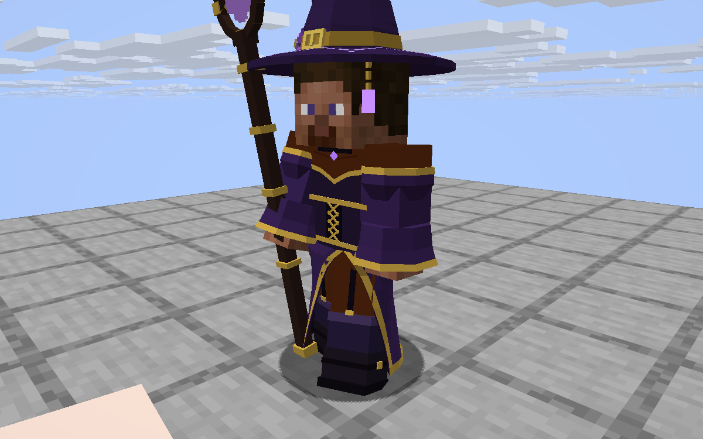
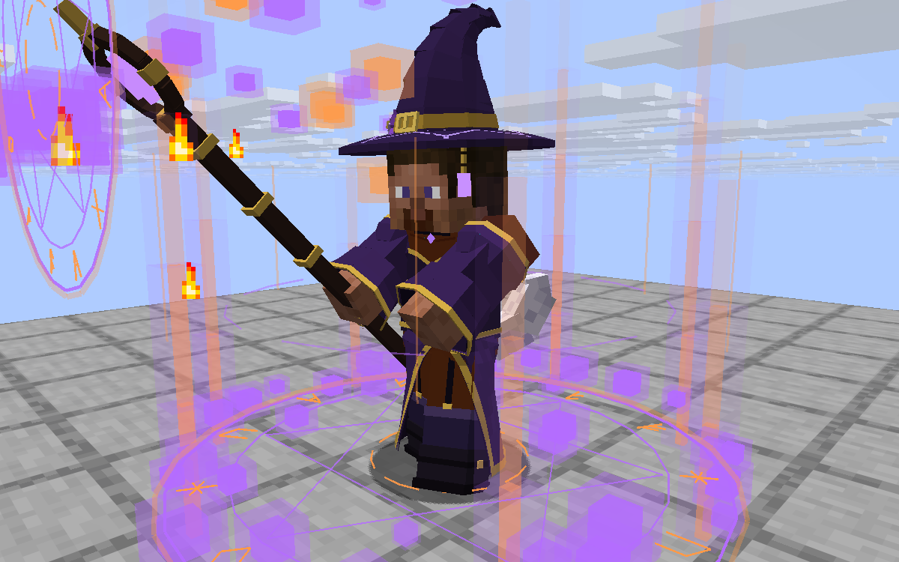
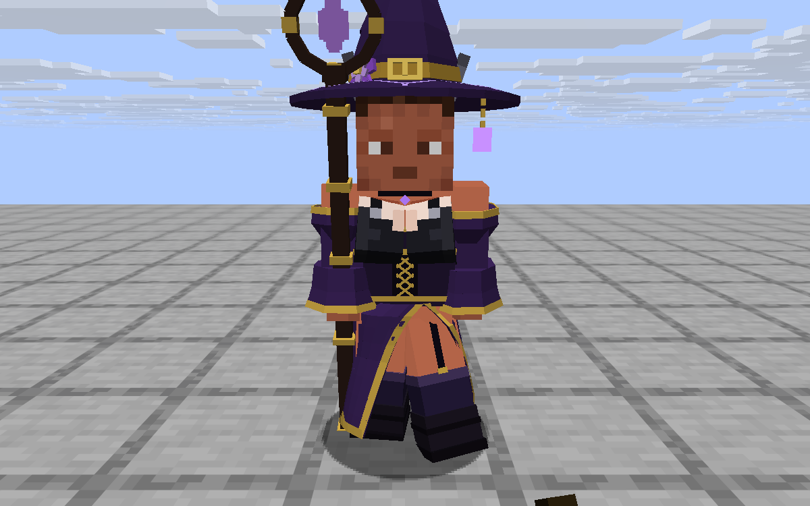

# Kotost Mage

A mage for [Horizon](https://playhorizon.dev) (Minecraft: Java Edition 26.3 rewritten in Rust): six spells, mana,
mastery, and the mage's hat, dress and staff drawn on your player. **Early version (0.6.1)**: playable, numbers
still being tuned.

Two parts, both in this repository:

- **Kotost Mage** (`kotost_mage`, native mod, the root folder): the spells, the mana bar, the clothes on the model,
  the cast pose and effects. Client and server: the server counts mana and casts, every player sees the effects.
- **Kotost Mage Items** (`kotost_mage_items`, content mod, `content/`): the three items with their recipes, and the
  spells' sound events. The sounds are the game's own (evoker, ghast, explosions, glass, thunder, beacon,
  warden): no audio files are shipped.

**Needs [Kotost Bust](https://github.com/Leks2000/kotost-body)** (`kotost_body` 0.4): the dress hugs its bust and
follows its hourglass figure. With [Kotost First Person](https://github.com/Leks2000/kotost-firstperson) you see the
dress and the staff when you look down.

<table>
  <tr>
    <td width="33%"></td>
    <td width="33%"></td>
    <td width="33%"></td>
  </tr>
</table>

## Spells

Hold the **Mage's Staff** in a hand and press the spell's key. Each spell first gathers (the mage winds up, a circle
of runes grows, sparks fly into the crystal), then goes off where you look; an aim preview shows where.

| Key | Spell | What it does |
| --- | --- | --- |
| `R` | Fireball | A ball of fire that locks on a mob near the crosshair; a small blast, breaks no blocks. |
| `G` | Shadow step | Teleports you 5-12 blocks where you look. |
| `Z` | Meteor | A rock falls from the sky onto the aimed spot: crater, flying blocks, fire, smoke. |
| `X` | Absolute zero | A ring of ice: mobs freeze in place, then the ice shatters. |
| `C` | Chain lightning | Jumps between up to 5 mobs; a real bolt hits the last one. |
| `N` | Supernova | You rise, charge, and blow up everything around you. |

Mana refills over time (bar left of the hotbar, with the spells' cooldowns). Every spell levels up as you cast it (shorter wind-up and cooldown).
The hat, the dress and the staff each add mana and faster cooldowns. Keys and numbers are in the settings file.

## Items and recipes

| Item | Slot | Recipe (crafting table) |
| --- | --- | --- |
| Mage's Staff | hand | stick, gold ingot, amethyst shard on a diagonal |
| Mage's Hat | head | amethyst shard on top / leather / leather, gold ingot, leather |
| Mage's Dress | chest | leather, amethyst, leather / purple wool, gold ingot, purple wool / 3 purple wool |

They are in the creative tab **Kotost Mage** too. The clothes show only while worn, the staff while held; without
them your own skin shows.

## Install

You need the Horizon launcher from [playhorizon.dev](https://playhorizon.dev) and a Microsoft account that owns
Minecraft: Java Edition. Install all three: Kotost Bust, Kotost Mage and Kotost Mage Items.

1. Launcher → **Mods**: find the three in the registry (once it lists them), or press **Add from GitHub** with
   `https://github.com/Leks2000/kotost-body` and then `https://github.com/Leks2000/kotost-mage`.
2. The launcher warns that native mods run with full access to your computer: read the source first.
3. It builds the game with the mods (the first build takes 20-40 minutes, later ones a few), then Play.

For multiplayer the server needs the same mods (the spells are cast on the server).

## Settings: `kotost-mage.txt`

The mod writes `config/kotost-mage.txt` in the game folder on its first run (the server's in the server's folder).
The game re-reads it twice a second. The spells' numbers (mana, damage, radii, cooldowns) are the server's; the
screen effects, the clothes and the keys are each player's own. `kotost-mage.txt` in this repository is the file the
mod writes, with every key, its default and what it does. The main ones:

| Key | Default | What it does |
| --- | --- | --- |
| `key_fireball` ... `key_nova` | `r g z x c n` | The spells' keys. |
| `mana_max`, `mana_regen` | `100`, `4` | Mana and how fast it refills (per second). |
| `need_staff` | `1` | `0`: cast without the staff. |
| `<spell>_cost`, `<spell>_cooldown`, `<spell>_windup` | | Each spell's mana, cooldown and wind-up (seconds). |
| `windup_scale` | `1.0` | All wind-ups at once (`0`: instant). |
| `mastery_max`, `mastery_casts`, `mastery_speed` | `10`, `5`, `4` | Levels, casts per level, % faster per level. |
| `meteor_blocks`, `nova_blocks` | `1` | `0`: no craters (the blasts and effects stay). |
| `meteor_radius`, `meteor_debris` | `36`, `600` | Crater size and flying blocks. |
| `fire_ignite` | `0` | `1`: the fireball sets fire around its blast. |
| `shake`, `flash`, `dust`, `recoil` | `1.0` | Screen effects (`0`: off). |
| `hud`, `aim` | `1` | Mana bar, aim preview. |
| `skirt_len`, `slit`, `stockings`, `stance` | `12.6`, `1.0`, `1`, `1.0` | The dress: length, side slit, stockings, idle stance. |
| `cast_fx`, `sparks`, `pillar` | `1` | The circle of runes, sparks, the pillar of light. |

Mastery is kept by the server in `config/kotost-mage-mastery.txt`.

**Careful:** the meteor and the supernova dig real craters and set fires. Turn `meteor_blocks` and `nova_blocks` to
`0` on a server where that matters.

## How it works

`mage.rs` is the whole mod (module `crate::game::kotost_mage`: settings, mana, network, spells, HUD, light, fog,
camera shake, cast effects, clothes). `pose.rs` is the cast pose and the stance (`horizon_client::kotost_mage_pose`),
`mute.rs` keeps vanilla's explosion bang quiet where the mod's own blast goes off. `hooks/*.rs` are one-line hooks;
`horizon-mixin.toml` lists them. Network: client → server `kotost_mage:cast`; server → client `kotost_mage:mana`,
`kotost_mage:fx`.

Built for Horizon `fdc87ae` (Nightly 2026-11-08); the launcher pins that commit when it builds the mod.

## License

MIT, see [LICENSE](LICENSE). Not affiliated with Mojang, Microsoft or the Horizon project.
